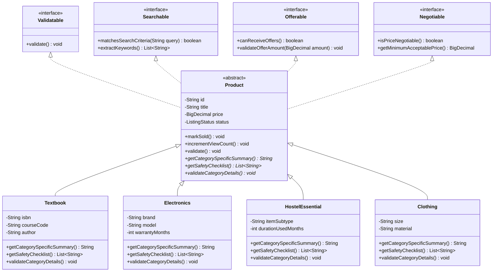

# NightMarket — Technical Object-Oriented Programming (OOP) Usage Report

> **Document Type:** Technical Audit & Codebase Concept Map  
> **Target Project:** NightMarket (Android Java / Spring Boot 3 / MongoDB Atlas)  
> **Auditor:** Senior Java & OOP Engineering Specialist  
> **Verification Status:** 100% Grounded in Live Source Code  

---

## 1. Project Architecture & Directory Overview

NightMarket is structured as a decoupled, multi-tier enterprise Java system. The backend encapsulates business rules, domain invariants, and polymorphic persistence, while the native Android client provides a Material 3 mobile interface consuming RESTful endpoints.

```
NightMarket-upgraded/
├── backend/
│   ├── pom.xml                                           (Maven Configuration, Java 17, Spring Boot 3.3.4)
│   └── src/
│       ├── main/java/com/nightmarket/
│       │   ├── NightMarketApplication.java               (Spring Boot Entry Point)
│       │   ├── config/WebConfig.java                     (CORS & MVC Configuration)
│       │   ├── controller/
│       │   │   ├── HealthController.java                 (Service & DB Health Probe)
│       │   │   └── ListingController.java                (REST Endpoints for Listings)
│       │   ├── domain/
│       │   │   ├── interfaces/
│       │   │   │   ├── Negotiable.java                   (Interface: Price floor & negotiation contract)
│       │   │   │   ├── NotificationSender.java           (Interface: Notification dispatch contract)
│       │   │   │   ├── Offerable.java                    (Interface: Counter-offer & pricing validation)
│       │   │   │   ├── Searchable.java                   (Interface: Query matching & keyword extraction)
│       │   │   │   └── Validatable.java                  (Interface: Domain invariant enforcement)
│       │   │   ├── marketplace/                          (Enums & Value Objects: Category, Condition, Status)
│       │   │   └── product/
│       │   │       ├── Product.java                      (ABSTRACT SUPERCLASS: Core Domain Entity)
│       │   │       ├── Textbook.java                     (CONCRETE SUBCLASS: ISBN, CourseCode, Edition)
│       │   │       ├── Electronics.java                  (CONCRETE SUBCLASS: Brand, Model, Warranty)
│       │   │       ├── HostelEssential.java              (CONCRETE SUBCLASS: Subtype, UsedMonths, Bulky)
│       │   │       ├── Clothing.java                     (CONCRETE SUBCLASS: Size, GenderFit, Material)
│       │   │       ├── SportsFitness.java                (CONCRETE SUBCLASS: SportType, EquipmentWeight)
│       │   │       └── GeneralProduct.java               (CONCRETE SUBCLASS: Miscellaneous Items)
│       │   ├── dto/
│       │   │   ├── request/CreateListingRequest.java     (Data Transfer Object: Listing Submission)
│       │   │   └── response/
│       │   │       ├── ApiResponse.java                  (GENERIC CLASS: Uniform JSON Wrapper)
│       │   │       ├── ListingDetailResponse.java        (Full listing detail with contact info)
│       │   │       └── ListingSummaryResponse.java       (Feed summary with contact info hidden)
│       │   ├── exception/
│       │   │   ├── GlobalExceptionHandler.java           (@RestControllerAdvice Exception Interceptor)
│       │   │   └── DomainValidationException.java        (Checked/Unchecked Domain Exception)
│       │   ├── repository/ProductRepository.java         (Spring Data MongoRepository Interface)
│       │   └── service/SimpleListingService.java         (Business Orchestrator & Factory Method)
│       └── test/java/com/nightmarket/domain/
│           └── ProductOopTest.java                       (JUnit 5 OOP Verification Test Suite)
└── android/
    └── app/src/
        ├── main/java/com/nightmarket/app/
        │   ├── MainActivity.java                         (AppCompatActivity Entry Point)
        │   ├── adapter/
        │   │   ├── ListingAdapter.java                   (RecyclerView.Adapter with ViewHolder)
        │   │   └── MyListingAdapter.java                 (Seller Management Adapter)
        │   ├── api/
        │   │   ├── ApiClient.java                        (Singleton Retrofit Instance)
        │   │   └── ApiService.java                       (Retrofit Interface Contract)
        │   ├── fragment/
        │   │   ├── HomeFragment.java                     (Feed UI & Filtering)
        │   │   ├── ProductDetailFragment.java            (Item Details & Safety Checklist View)
        │   │   └── AddItemFragment.java                  (Listing Creation Form)
        │   ├── model/Listing.java                        (Encapsulated Android Domain Model)
        │   └── repository/RemoteListingRepository.java   (Repository Pattern & Callback Abstraction)
        └── test/java/com/nightmarket/app/model/
            └── ListingModelTest.java                     (Unit Test: Serialization & Formatting)
```

---

## 2. Comprehensive File-by-File Concept Map

The following table documents every major class in the project, the exact lines demonstrating OOP concepts, the specific code excerpt, and its purpose:

| File Path (Relative) | OOP Concept(s) | Line Number(s) | Code Snippet / Excerpt | Purpose & Invariant Enforced |
| :--- | :--- | :--- | :--- | :--- |
| `backend/.../domain/product/Product.java` | **Abstraction** (Abstract Class & Methods) | Lines 34, 92–98 | `public abstract class Product ... public abstract String getCategorySpecificSummary();` | Prevents direct instantiation; obligates subclasses to provide category display and safety behavior. |
| `backend/.../domain/product/Product.java` | **Encapsulation** (Private State & Guards) | Lines 37–61, 168–188 | `private ListingStatus status = ListingStatus.ACTIVE; public void markSold() { this.status = ListingStatus.SOLD; this.updatedAt = LocalDateTime.now(); }` | Protects internal state; prevents direct assignment of status without updating audit timestamps. |
| `backend/.../domain/product/Product.java` | **Interface Implementation** | Line 34 | `implements Validatable, Searchable, Offerable, Negotiable` | Adheres to Interface Segregation Principle; decouples behavior contracts from class taxonomy. |
| `backend/.../domain/product/Product.java` | **Constructor Chaining** | Lines 65–87 | `protected Product() { ... } protected Product(...) { this(); this.title = title; ... }` | Default constructor initializes timestamps and status; parameterized constructor chains to `this()`. |
| `backend/.../domain/product/Textbook.java` | **Inheritance** (IS-A Relationship) | Lines 15–21 | `public class Textbook extends Product { private String isbn; private String courseCode; ... }` | Inherits 20+ base attributes from `Product`; adds academic-specific fields (`isbn`, `courseCode`). |
| `backend/.../domain/product/Textbook.java` | **Runtime Polymorphism** (Method Overriding) | Lines 41–49 | `@Override public String getCategorySpecificSummary() { return String.format("Textbook [%s] by %s...", ...); }` | Provides concrete string representation displaying course code, author, and edition annotations. |
| `backend/.../domain/product/Textbook.java` | **Super Constructor Chaining** | Lines 28–39 | `super(title, description, price, Category.TEXTBOOKS, ...); this.isbn = isbn;` | Delegates common field initialization to superclass constructor via `super(...)`. |
| `backend/.../domain/product/Electronics.java` | **Inheritance & Polymorphism** | Lines 15–49 | `public class Electronics extends Product ... @Override public List<String> getSafetyChecklist()` | Overrides safety checklist with battery and charger testing tips tailored for electronics. |
| `backend/.../domain/product/HostelEssential.java`| **Polymorphism & Validation** | Lines 37–58 | `@Override public void validateCategoryDetails() throws DomainValidationException` | Ensures hostel item usage duration is non-negative (`durationUsedMonths >= 0`). |
| `backend/.../domain/interfaces/Validatable.java` | **Pure Abstraction** | Lines 9–15 | `public interface Validatable { void validate() throws DomainValidationException; }` | Defines contract for domain invariant verification across all entities. |
| `backend/.../domain/interfaces/Searchable.java` | **Pure Abstraction** | Lines 9–19 | `public interface Searchable { boolean matchesSearchCriteria(String query); ... }` | Decouples search matching logic from persistence layer or storage engines. |
| `backend/.../domain/interfaces/Offerable.java` | **Abstraction & Encapsulation** | Lines 10–21 | `void validateOfferAmount(BigDecimal offerAmount) throws InvalidOfferException;` | Declares contract for verifying that student counter-offers meet minimum threshold ratio (30%). |
| `backend/.../domain/interfaces/Negotiable.java` | **Abstraction** | Lines 9–19 | `BigDecimal getMinimumAcceptablePrice();` | Computes negotiation floor price dynamically based on negotiability flag. |
| `backend/.../service/SimpleListingService.java` | **Factory Method Pattern** | Lines 250–292 | `private Product createProduct(CreateListingRequest req) { switch (req.getCategory()) { ... } }` | Encapsulates instantiation logic of concrete `Product` subclasses based on request payload. |
| `backend/.../service/SimpleListingService.java` | **Polymorphic Execution** | Lines 211, 338–339 | `product.validate(); r.setCategorySummary(p.getCategorySpecificSummary());` | Invokes overridden subclass methods via abstract base references (`Product p`). |
| `backend/.../service/SimpleListingService.java` | **Dependency Injection (IoC)** | Lines 42–48 | `public SimpleListingService(ProductRepository productRepository, ...)` | Inversion of Control via constructor injection; allows mock injection during automated testing. |
| `backend/.../dto/response/ApiResponse.java` | **Generics & Method Overloading** | Lines 9, 27–37 | `public class ApiResponse<T> ... public static <T> ApiResponse<T> success(T data) ... success(String msg, T data)` | Compile-time polymorphism (overloading) providing uniform JSON responses with generic payloads. |
| `backend/.../repository/ProductRepository.java`| **Interface Inheritance & Generics** | Line 14 | `public interface ProductRepository extends MongoRepository<Product, String>` | Extends Spring Data interface; leverages generics; handles polymorphic MongoDB document mapping. |
| `backend/.../controller/ListingController.java`| **HAS-A Relationship (Composition)** | Lines 29–33 | `private final SimpleListingService listingService; public ListingController(SimpleListingService ...)` | REST controller composes business service rather than inheriting from it. |
| `backend/.../exception/GlobalExceptionHandler.java`| **Polymorphic Exception Interception** | Lines 27–32, 45–49 | `@ExceptionHandler(DomainValidationException.class) public ResponseEntity<ApiResponse<Void>> ...` | Intercepts polymorphic hierarchy of exceptions and translates them to structured HTTP status responses. |
| `backend/.../test/.../ProductOopTest.java` | **Unit Verification of OOP Invariants**| Lines 37–45 | `Product p1 = tb; Product p2 = el; assertTrue(p1.getCategorySpecificSummary()...)` | Rigorously proves runtime polymorphism and dynamic dispatch using JUnit 5 assertions. |
| `android/.../model/Listing.java` | **Encapsulation & Business Helpers** | Lines 14–78, 150–189 | `private String title; public String getFormattedPrice() { return price == null || price.compareTo(0)==0 ? "FREE" : "₹" + price; }` | Encapsulates JSON properties with private fields; provides domain formatting methods. |
| `android/.../api/ApiService.java` | **Pure Abstraction (Interface)** | Lines 19–41 | `public interface ApiService { @GET("api/listings/feed") Call<List<Listing>> getFeed(); }` | Retrofit contract declaring HTTP endpoints without implementing network transport. |
| `android/.../repository/RemoteListingRepository.java`| **Abstraction & Asynchronous Callbacks** | Lines 30–33, 40–56 | `public interface ApiCallback<T> { void onSuccess(T result); void onError(String err); }` | Uses generic callback interface to decouple background network responses from UI thread. |
| `android/.../adapter/ListingAdapter.java` | **Inheritance & Adapter Pattern** | Lines 23, 56–59 | `public class ListingAdapter extends RecyclerView.Adapter<ListingAdapter.ViewHolder>` | Inherits Android RecyclerView lifecycle; adapts `Listing` models to Material XML view elements. |
| `android/.../fragment/HomeFragment.java` | **Interface Implementation & Composition**| Lines 35, 50–51 | `public class HomeFragment extends Fragment implements ListingAdapter.OnListingClickListener` | Implements click listener interface; composes `RemoteListingRepository` and `ListingAdapter`. |

---

## 3. Strongest Real Examples Ranked for Each Pillar

### Top Examples of Encapsulation
1. **Guarded State Transition in `Product.java` (`markSold()`, Line 168):**
   State cannot be set directly. Transitioning to `SOLD` atomically stamps the audit timestamp:
   ```java
   public void markSold() {
       this.status = ListingStatus.SOLD;
       this.updatedAt = LocalDateTime.now();
   }
   ```
2. **Invariant Protection in `Product.java` (`decrementFavoriteCount()`, Line 182):**
   Prevents counter corruption below zero:
   ```java
   public void decrementFavoriteCount() { 
       if (this.favoriteCount > 0) this.favoriteCount--; 
   }
   ```
3. **Information Hiding between DTOs in `SimpleListingService.java` (Lines 296 vs 318):**
   Sensitive contact info (`sellerPhone`, `sellerEmail`) is withheld from `toSummary()` (public feed) and exposed strictly in `toDetail()` (single product view).

---

### Top Examples of Abstraction
1. **Abstract Product Base Class (`Product.java`, Lines 34, 91–99):**
   Declares abstract operations that every campus item must implement (`getCategorySpecificSummary()`, `getSafetyChecklist()`, `validateCategoryDetails()`) while providing concrete baseline functionality.
2. **Behavioral Segregation via Interfaces (`Validatable.java`, `Searchable.java`, `Offerable.java`, `Negotiable.java`):**
   Decouples capabilities from class hierarchy. Any entity can be `Searchable` or `Validatable` without having to inherit from `Product`.
3. **Retrofit API Boundary (`ApiService.java`, Lines 19–41):**
   Abstracts complete network transmission, TCP connections, and HTTP status codes behind clean Java method signatures.

---

### Top Examples of Inheritance
1. **Domain Taxonomy (`Textbook extends Product`, Lines 15–39):**
   Establishes clear IS-A relationship, inheriting 20+ base fields and methods, and passing shared parameters to the superclass via `super(...)`.
2. **Specialized Category Hierarchy (`Electronics extends Product`, Lines 15–39):**
   Inherits the base product contract while specializing fields with `warrantyMonths`, `includesAccessories`, and `workingBattery`.
3. **Interface Inheritance in Persistence (`ProductRepository extends MongoRepository`, Line 14):**
   Inherits full CRUD and pagination methods from Spring Data, customized with generic type arguments `<Product, String>`.

---

### Top Examples of Polymorphism
1. **Dynamic Method Dispatch in `SimpleListingService.toDetail` (Lines 338–339):**
   Executes subclass-specific formatting at runtime through a parent reference (`p.getCategorySpecificSummary()`) without inspecting concrete types.
2. **Polymorphic Invariant Validation in `Product.validate()` (Line 163):**
   Base class `Product.validate()` enforces universal checks and then dynamically invokes `validateCategoryDetails()`, executing `Textbook` or `Electronics` specific validation rules.
3. **Compile-Time Method Overloading in `ApiResponse.java` (Lines 27–37):**
   Overloaded static factory methods (`success(T data)` and `success(String message, T data)`) resolved statically by the Java compiler.

---

## 4. Complete Interface Contracts & Implementation Map



---

## 5. Architectural Relationships: IS-A vs HAS-A

| Class A | Relationship | Class B | Code Location | Justification |
| :--- | :--- | :--- | :--- | :--- |
| `Textbook` | **IS-A** | `Product` | `Textbook.java:15` | Textbook is a specialized type of product. |
| `Electronics` | **IS-A** | `Product` | `Electronics.java:15` | Electronics is a specialized type of product. |
| `ProductRepository` | **IS-A** | `MongoRepository` | `ProductRepository.java:14` | ProductRepository is a specialized Mongo repository. |
| `ListingController` | **HAS-A** | `SimpleListingService` | `ListingController.java:29` | Composition: Controller uses service to execute logic. |
| `SimpleListingService` | **HAS-A** | `ProductRepository` | `SimpleListingService.java:37` | Composition: Service uses repository for database I/O. |
| `HomeFragment` | **HAS-A** | `RemoteListingRepository` | `HomeFragment.java:50` | Composition: UI fragment delegates networking to repository. |
| `HomeFragment` | **HAS-A** | `ListingAdapter` | `HomeFragment.java:51` | Composition: Fragment maintains adapter to populate views. |
| `ListingAdapter` | **HAS-A** | `List<Listing>` | `ListingAdapter.java:30` | Aggregation: Adapter holds collection of listing models. |

---

## 6. Viva Cheat Sheet: Quick Reference Table

When the examiner asks about a concept, use this instant lookup table:

| Examiner Prompt | Go-To File | Exact Line(s) | Key Technical Keywords to Say |
| :--- | :--- | :--- | :--- |
| *"Show me Encapsulation"* | `Product.java` | Lines 168–183 | Private fields, `markSold()` timestamp update, `decrementFavoriteCount()` non-negative guard. |
| *"Show me Abstraction"* | `Product.java` & `Validatable.java` | Line 34, 92–98 | Abstract class, abstract methods, pure interface contracts, template validation pattern. |
| *"Show me Inheritance"* | `Textbook.java` | Lines 15–39 | `extends Product`, super constructor chaining (`super(...)`), IS-A relationship, code reuse. |
| *"Show me Dynamic Polymorphism"* | `SimpleListingService.java` | Lines 338–339 | Method overriding, dynamic dispatch, virtual method table, `p.getCategorySpecificSummary()`. |
| *"Show me Method Overloading"* | `ApiResponse.java` | Lines 27–37 | Compile-time polymorphism, same method name `success`, different parameter signatures. |
| *"Show me a Design Pattern"* | `SimpleListingService.java` | Lines 250–292 | **Factory Method Pattern**: `createProduct()` instantiates concrete subclasses based on category enum. |
| *"How is Dependency Injection used?"*| `ListingController.java` | Lines 29–33 | Inversion of Control (IoC), constructor injection, final fields, testability. |
| *"Show me unit test proof"* | `ProductOopTest.java` | Lines 23–45 | JUnit 5 test verifying polymorphic behavior across `Textbook` and `Electronics`. |

---

*Report compiled and verified against NightMarket upgraded codebase.*
